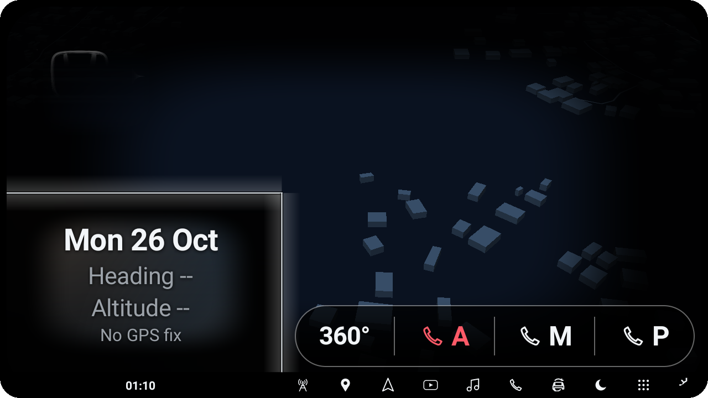
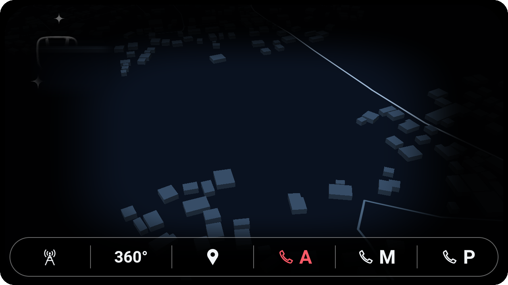

# Rehome: Launcher for Car

Free apps for Android car head units, **made mainly for cars that have a 360 camera**. Tested on one unit only. Made with a lot of help from AI.

**Download both:** [Releases](../../releases)

## Don't miss: the 360 player

Rehome: Go opens a 360 player when you **hold the 360 button**. Get it here: [car360-player](https://github.com/bv-ack/car360-player/releases). Without it, holding 360 does nothing useful.

## Which one do I want?

**Rehome: Go** (`Rehome-Go.apk`)
- A tiny Home app. Pressing Home opens Google Maps.
- Best if you live in Google Maps, the radio and YouTube and want them one tap away.
- Adds a corner frame, a movable pill of buttons (360, Maps, radio/YouTube) and a speed light.
- Includes **Boot Pack**, which makes your own boot logo, animation and wallpaper.

**Rehome 1.7** (`Rehome.apk`)
- A full home screen with an offline map and a contacts bar.
- Best if you want a proper home screen, with room for the unit's own 360 picture-in-picture.
- Also has a speed glow and themes.

You can install both, but only one can be the Home app at a time.

## Install

Download the APK, open it, allow installing from unknown sources. Set the app as your Home app, then restart the unit. **Read [RELEASE_NOTES.md](RELEASE_NOTES.md) first.** It lists what to know before you use them.

More: [TODO.md](TODO.md) (what is left, for anyone who wants to continue) · [THEMING.md](THEMING.md)

MIT licence. Independent hobby project, not affiliated with any brand.
